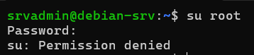
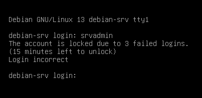
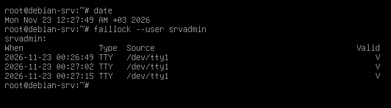
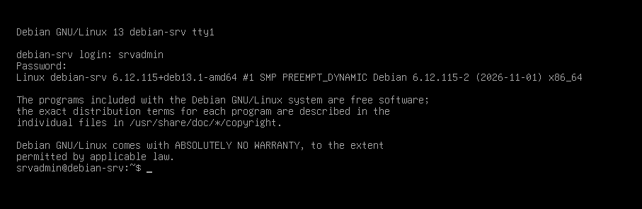
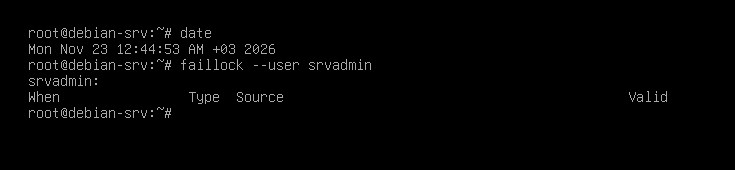
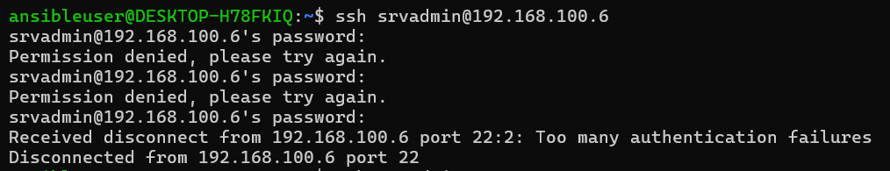

# Тестирование
## SUDO
### 5.2.7 Ensure access to the su command is restricted

### 5.2.6 Ensure sudo timestamp_timeout is configured

## PAM
### 5.3.3.1.1 Ensure password failed attempts lockout is configured + 5.3.3.1.2 Ensure password unlock time is configured

## SSH
### 5.1.18 Ensure sshd MaxAuthTries is configured
